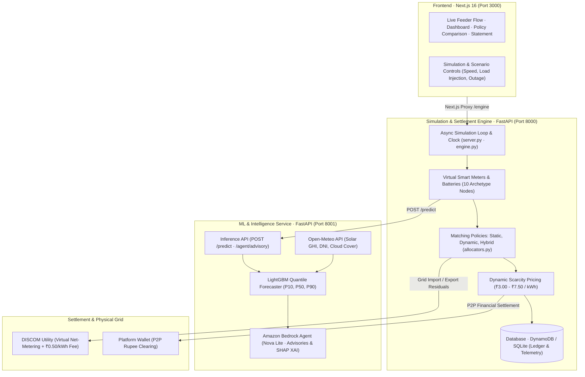

# GridZero

Intelligent peer-to-peer microgrid energy sharing platform that matches rooftop solar surplus with neighborhood deficit on the shared feeder dynamically.

---

## Overview

Traditional setups sell rooftop solar back to the utility at low feed-in tariffs (~₹3/kWh) while neighbors buy at retail (~₹8/kWh). **GridZero** enables direct community microgrid sharing:

- **Virtual Feeder Allocation:** Matches prosumer exports to neighbor imports across homes on the same feeder via virtual net metering—no dedicated wiring required.
- **10 Archetype Microgrid & Demand Response:** Models 10 realistic Indian household archetypes with 15 appliance profiles and automated flexible load scheduling (EV charging, washers) shifted into peak solar generation hours.
- **Dual Forecaster:** Predicts household load and solar generation using LightGBM quantile regression ($P_{10}, P_{50}, P_{90}$) with live Open-Meteo solar irradiance.
- **Three Allocation Modes:** Evaluates **Static** (water-filling equal share), **Dynamic** (priority queue), and **Hybrid** (base share + priority) policies benchmarked on Jain's Fairness Index.
- **Scenario & Grid Outage Resilience:** Simulates weather presets (Clear, Heatwave, Monsoon, Winter) and grid blackout scenarios where the microgrid islands onto solar, battery storage (with state-of-charge tracking and reserve margins), and P2P sharing.
- **Day-Ahead Look-Ahead Caching:** Synchronizes with the simulation clock to precompute 24-hour load and solar horizons in-memory, eliminating per-hour API bottlenecks and mirroring real-world utility dispatch.
- **Decoupled Settlement:** Kilowatt-hour units reassign on utility bills; money clears peer-to-peer at dynamic mid-market rates (₹3.00–₹7.50) with a ₹0.50/kWh DISCOM wheeling charge.
- **GenAI Advisory:** Amazon Bedrock (Nova Lite / Claude 3 Haiku) with SHAP attribution for plain-English dispatch guidance and weather-shock alerts.

---

## System Architecture

---

## Tech Stack

| Layer | Technologies |
|---|---|
| **Frontend** | Next.js 16, React 19, Tailwind CSS and SWR |
| **Backend** | FastAPI and Uvicorn |
| **Storage** | Amazon S3 and DynamoDB |
| **AI/ML** | LightGBM, SHAP and Amazon Bedrock |
| **Data & APIs** | Open-Meteo Weather API |
| **Simulation** | Discrete-Event Engine and Virtual Smart Meters |
| **Containerization & Deployment** | Docker, Docker Compose, AWS ECR, AWS ECS Fargate and GitHub Actions |